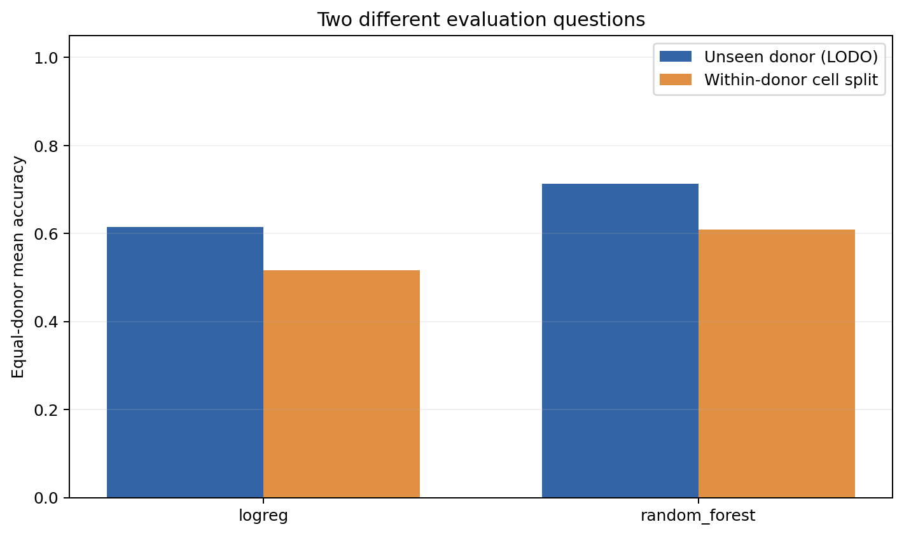

# DonorShift-Bench

When you're working with single-cell data from several patients, the train/test split matters. A classifier might perform well on cells from patients it has already encountered and struggle when the next sample comes from someone new.

DonorShift-Bench makes it easy to check both situations. It trains cell-type classifiers using raw scRNA-seq counts, keeps gene selection inside the training split, and saves the predictions and per-donor results so you can see where a model works and where it doesn't.

## Two ways to evaluate a model

**Leave-one-donor-out (LODO):** train on all but one donor, test on the donor left out, and repeat for every donor. Use this when the question is whether a classifier can handle a *new patient*.

**Within-donor cell split:** split cells separately within each donor, with the same donors allowed in both training and test sets. The `compare` command repeats this split with different seeds. This answers a different question: how well does the model classify held-out cells from *donors already represented in training*?

In both cases, the code chooses genes using training cells only. Donor overlap is intentional in the second protocol, not an accidental data leak. The comparison report makes that difference explicit.

## Install

Python 3.10 or newer is required.

```bash
git clone https://github.com/sialock/DonorShift-Bench.git
cd DonorShift-Bench
python -m pip install -e .
```

To run the tests:

```bash
python -m pip install -e '.[dev]'
python -m pytest -q
```

## Try the split comparison

There's a small **synthetic** dataset in `examples/data/`, so you can run the project without downloading patient data.

```bash
donorshift compare \
  --input examples/data/synthetic_sc_counts.csv \
  --output results/comparison \
  --models logreg random_forest \
  --top-genes 48 \
  --test-fraction 0.2 \
  --random-repeats 3 \
  --dataset-kind synthetic
```

Open `results/comparison/comparison_report.html` in your browser. It works offline and shows both protocols side by side.



On the bundled synthetic example (8 donors, 384 cells, 64 genes, seed 42), I get:

| Model | Leave-one-donor-out | Within-donor split |
| --- | ---: | ---: |
| Logistic regression | 0.615 | 0.517 |
| Random forest | 0.714 | 0.608 |

These values are **equal-donor mean accuracies**. The within-donor number averages three seeded splits. The runs use the same fixed model settings, but they do **not** have the same training-set size or test distribution: the average LODO training set has 336 cells, versus 304 in the cell-split experiments.

The cell split is actually *lower* in this example. That's fine. A random split doesn't have to give a larger score, and a gap between these two protocols is not a direct measurement of how much donor information a model has learned. This dataset is artificial; the table is only a demonstration of the software.

## Running on your own data

Use a CSV with one row per cell. It needs a donor ID, a cell-type label, and at least two columns of **raw, nonnegative integer counts**.

```text
cell_id,donor_id,cell_type,CD3D,MS4A1,LYZ,EPCAM
cell_001,patient_01,CD4_T,8,0,1,0
...
```

For an annotated `.h5ad` file, install the optional reader:

```bash
python -m pip install -e '.[h5ad]'

donorshift validate --input cohort.h5ad \
  --donor-col patient_id --label-col cell_type --counts-layer counts

donorshift compare --input cohort.h5ad \
  --donor-col patient_id --label-col cell_type --counts-layer counts \
  --models logreg random_forest \
  --top-genes 3000 --random-repeats 3 \
  --dataset-kind public --accession GSE176078 \
  --output results/public_cohort
```

These commands assume that your `.h5ad` contains a **raw-count** layer called `counts` and verified `patient_id` and `cell_type` columns. Change the names to match your file. The tool does not download the dataset or create cell-type annotations for you. It loads the matrix into memory, so a large cohort needs enough RAM.

GSE176078 is one possible public breast-cancer dataset, but it isn't included here. See [the dataset notes](docs/PUBLIC_DATA.md) for its sources and the checks needed before using it. No real-patient results have been generated or claimed for this release.

## What gets saved

After `donorshift compare`, the output folder contains:

| File | Contents |
| --- | --- |
| `comparison.csv` | Main scores from both protocols, one row per model |
| `comparison_report.html` | Offline report with the comparison plot |
| `comparison.png` | The plot used in the report |
| `random_split_metrics.csv` | One row per model and random split |
| `random_per_donor_metrics.csv` | Accuracy, macro F1 and balanced accuracy for each donor in each random split |
| `random_per_class_metrics.csv` | Per-class precision, recall and F1 |
| `random_predictions.csv` | Predictions for the held-out cells in each random split |
| `random_split_manifest.json` | Seeds, donor overlap, selected genes, split sizes and cell-ID fingerprints |
| `cohort_audit.csv` | Cell counts by donor and annotated cell type |
| `comparison_summary.json` | Dataset provenance, settings and result summary |
| `donor_held_out/` | The complete LODO output, including its own report and fold manifest |

For just the original donor-held-out benchmark, `donorshift run` still works:

```bash
donorshift run --input examples/data/synthetic_sc_counts.csv \
  --output results/lodo --models logreg random_forest --top-genes 48
```

## Models and how to read the numbers

The package has logistic regression, random forest and MLP baselines, plus an optional small Transformer (`pip install -e '.[transformer]'`). These are deliberately simple baselines. The Transformer is trained from scratch; it isn't a pretrained single-cell foundation model.

Each model uses fixed hyperparameters. The code does not tune them against the held-out donor. The feature selection step uses a straightforward dispersion score after library-size normalization and `log1p`, **not** Scanpy's batch-aware or Seurat's HVG procedure.

Scores are reported per donor because a pooled accuracy can hide poor performance on a smaller patient sample. Random-split repetitions can test some of the same cells more than once, so those repetitions shouldn't be treated as independent test cohorts. The difference between the two protocols is descriptive: changes in donor representation, training-set size, class balance and biology can all contribute.

For a research study, check the annotation quality, donor identity, class coverage and upstream preprocessing before drawing conclusions. Batch correction or feature selection done globally *before* running this tool can leak information even when the benchmark's internal splits are correct. See [methods](docs/METHODS.md).

## Repository layout

- `src/donorshift/` — loaders, training-only transforms, models, benchmarks and reports
- `tests/` — regression tests, data checks, donor isolation and split comparison checks
- `examples/data/` — synthetic raw counts, not patient data
- `examples/results/` — example LODO and split-comparison outputs
- `docs/` — methods and public-data instructions

## License

MIT. See [LICENSE](LICENSE).
