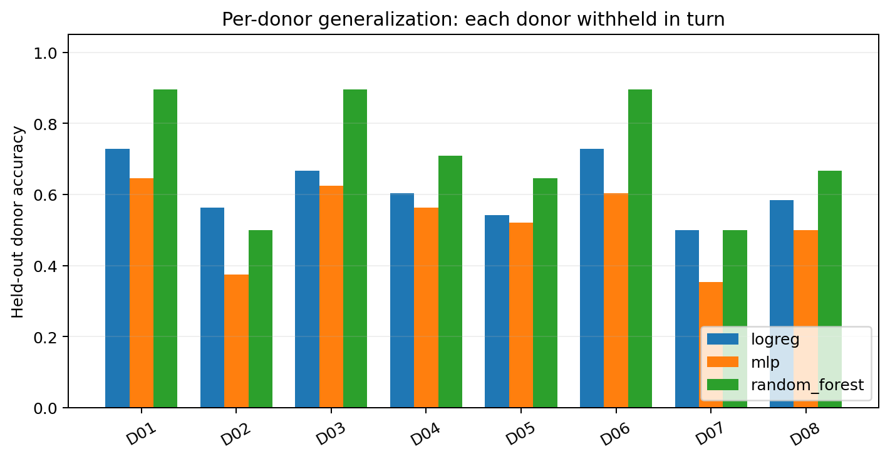
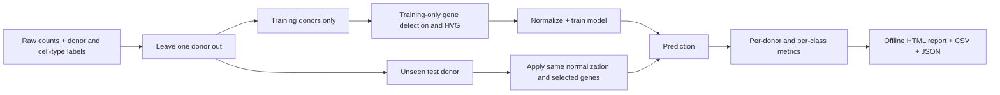

# DonorShift-Bench

**Reproducible, leakage-aware benchmarking for single-cell cell-type classification on unseen donors.**

DonorShift-Bench evaluates classification algorithms using *leave-one-donor-out* (LODO) validation, performs feature selection **only inside the training portion of each fold**, and produces a self-contained HTML report and downloadable benchmark tables.

> **Scientific status:** v0.1 is a tested research-software MVP. The bundled demonstration is **100% synthetic**, not a published tumor dataset. It does **not** reproduce any unpublished breast cancer experiment or establish clinical validity.



## Why it matters

Random cell-level train/test splits can put cells from the *same patient* into both sets. This tests within-donor recognition and may overstate performance on new patients. Here, every test cell belongs to a donor excluded from its model's training data and all gene selection.



## Install and run in under 2 minutes

Python 3.10+:

```bash
python -m pip install -e .
donorshift make-demo --output examples/data/synthetic_sc_counts.csv
donorshift validate --input examples/data/synthetic_sc_counts.csv
donorshift run --input examples/data/synthetic_sc_counts.csv \
  --output results/demo --models logreg random_forest --top-genes 48
```

Open `results/demo/report.html` in a web browser. **No network or credentials are required** after installing dependencies. The example uses synthetic 8-donor counts with artificial cell-type markers.

### Real scRNA-seq input

CSV columns: `cell_id` (optional), `donor_id`, `cell_type`, followed by one column per gene with **raw, nonnegative, integer-like counts**.

```text
cell_id,donor_id,cell_type,CD3D,MS4A1,LYZ, EPCAM
...
```

For sparse AnnData `.h5ad`, install `python -m pip install -e '.[h5ad]'`. The input `.obs` must include donor and label columns, with gene names in `.var_names`:

```bash
donorshift run --input input.h5ad --counts-layer counts \
  --donor-col patient_id --label-col manual_celltype \
  --output results/patient_benchmark --models logreg random_forest mlp \
  --top-genes 3000
```

If raw counts are already in `.X`, omit `--counts-layer`. **Never supply log-normalized expression**: preprocessing expects raw counts. `.h5ad` is loaded in memory; for large cohorts, allocate sufficient RAM or pre-filter cells and genes in a **scientifically justified and leakage-safe** manner. If global preprocessing needs to be fit to data (e.g., HVG selection), do it *within each training fold*, not before this benchmark.

### Optional lightweight transformer

```bash
python -m pip install -e '.[transformer]'
donorshift run --input examples/data/synthetic_sc_counts.csv \
  --output results/transformer --models logreg transformer \
  --top-genes 32 --transformer-epochs 10
```

This is a compact, **randomly initialized** gene-token attention model, not a pretrained single-cell foundation model or a faithful recreation of a particular paper architecture. Its hyperparameters and training epochs are fixed, and it uses no held-out donor information for tuning. The transformer is resource intensive for large HVG sets. `logreg` and `random_forest` are the default baselines.

## Reproducible synthetic demonstration (not biological evidence)

A fixed 8-donor / 384-cell / 64-gene simulation (seed 7) was run with 48 train-selected genes per fold (seed 42, no hyperparameter search). These scores are **illustrations of the report**, not research conclusions:

| Baseline | Mean held-out donor accuracy | Worst held-out donor accuracy | Mean donor macro F1 |
|---|---:|---:|---:|
| Logistic regression | 0.615 | 0.500 | 0.622 |
| Random forest | **0.714** | 0.500 | **0.719** |
| MLP | 0.523 | 0.354 | 0.528 |

The MLP can emit non-convergence warnings at its fixed iteration budget; those warnings should be treated as diagnostic information. Synthetic data are deliberately imperfect; model ranking here **must not** be generalized to real tumors. The optional transformer was smoke-tested separately and is intentionally omitted from this default comparison.

The checked-in files under `examples/results/demo/` include the full, offline HTML report, plots and fold manifests.

## Outputs

| File | Description |
|---|---|
| `report.html` | Portable offline benchmark report with embedded visualizations |
| `summary.json` | Equal-donor mean accuracy, worst-donor result, pooled accuracy, mean test-present macro F1 and donor-cluster bootstrap intervals |
| `per_donor_metrics.csv` | Accuracy, macro F1 and balanced accuracy for each model and donor |
| `per_class_metrics.csv` | Precision, recall, F1 and support for each test-present cell type, with unseen-training-class indicator |
| `predictions.csv` | Held-out predictions and *uncalibrated* prediction confidence |
| `fold_manifest.json` | Training/test donor isolation, per-fold training cell counts, selected genes, train class distribution |
| `run_config.json` | Reproducibility settings and package versions |
| `donor_accuracy.png` | Per-donor grouped bar plot |
| `class_recall.png` | Support-weighted per-class recall heatmap |

## Scientific guardrails

1. **Donor isolation:** outer holdout is by donor ID, never random cells.
2. **Fit within training only:** minimum detected-cell filter, HVG rank and model fitting use training donors only. Independently normalized test cells use the training-selected gene indices.
3. **No held-out model tuning:** algorithm settings are fixed in `src/donorshift/models.py`; never pick a winner by repeatedly tuning on outer donors. For tuned comparisons, implement nested donor-grouped validation.
4. **Class absence:** `test_only_classes` flags classes completely absent from training. Such predictions are inherently unsupported, rather than quietly excluding these classes.
5. **Metric definition:** per-donor macro F1 averages across classes *present in that test donor*. Pooled accuracy weights donors with more cells more strongly; average donor accuracy weights each donor equally.
6. **Bootstrap scope:** interval is a descriptive percentile bootstrap of donors, not a calibrated uncertainty estimate or prospective validation.
7. **Transparency:** the HVG score is a simple dispersion heuristic (variance divided by mean after log-normalization), **not** the Seurat/Scanpy batch-aware HVG method. No batch correction, doublet removal or label harmonization is performed.
8. **Biological limits:** synthetic datasets are for functional tests, not proof of generalization. Complex cohorts require a documented label ontology, donor metadata quality audit, batch and tissue-shift sensitivity analysis, and external cohort testing.
9. **Privacy:** do not commit patient-identifying metadata, controlled-access counts, or unlicensed datasets to public GitHub repositories.

## Reproducibility / engineering

```bash
python -m pip install -e '.[dev]'
python -m pytest -q
python -m build
```

GitHub Actions CI runs tests on Python 3.10–3.12 and a small CLI smoke test. Core features work without GPU. Source layout follows the `src/` packaging convention and has no notebook-only execution dependency.

## Project structure

```text
src/donorshift/  # input validation, train-only transforms, baselines, metrics, reports, CLI
examples/data/   # synthetic counts only
examples/results/demo/  # frozen, reproducible example result tables and charts
tests/          # regression, data integrity, sparse/dense, no-leakage and CLI tests
.github/workflows/ci.yml
```

## Publication roadmap (not yet implemented)

- Grouped nested cross-validation and model calibration
- Domain-shift decomposition by assay/therapy/subtype with appropriately de-identified metadata
- Efficient out-of-core support for million-cell cohorts
- External public-dataset benchmark and comparison to established cell-label-transfer methods

**License:** MIT. This is research software; not for clinical decision making.